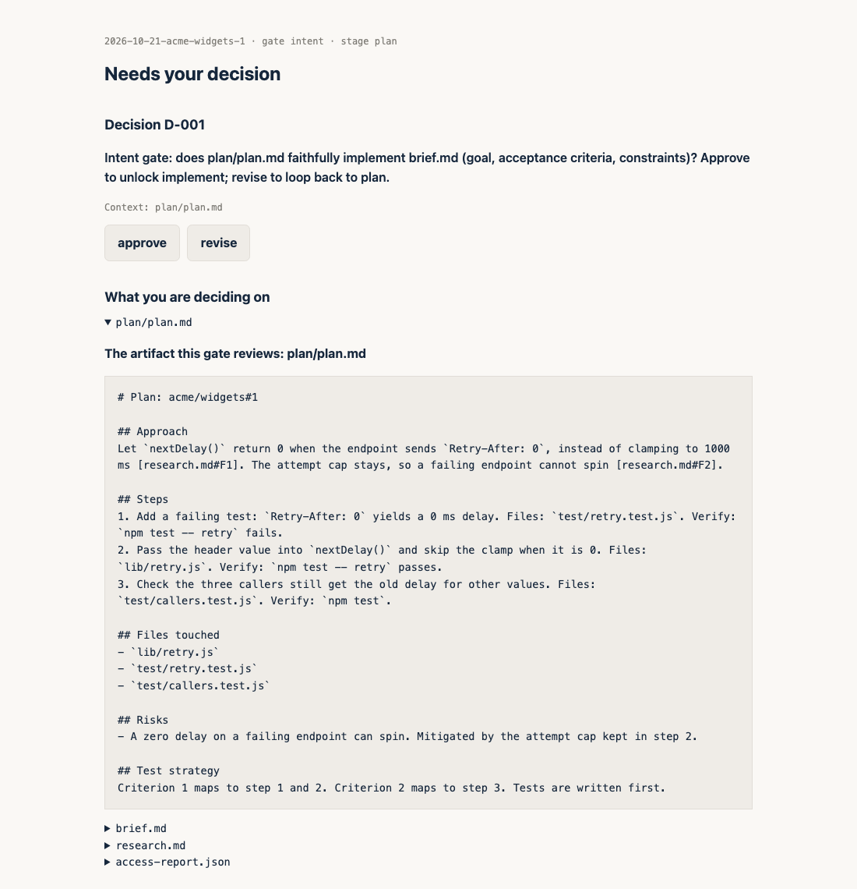
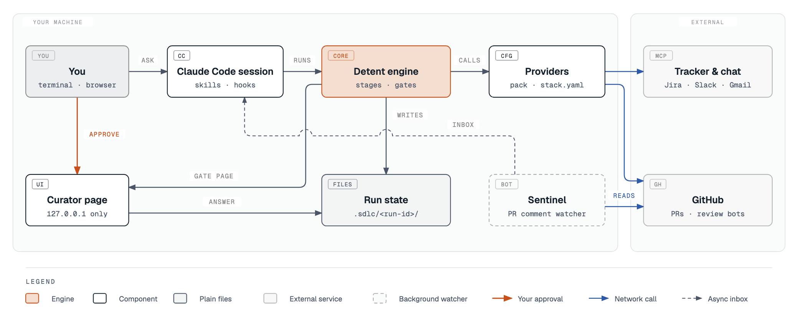

# Detent

[](https://github.com/Amanborn007/detent/actions/workflows/test.yml)
[](LICENSE)
[](https://code.claude.com/docs/en/plugins)
[](.claude-plugin/plugin.json)

**Hand Claude Code a ticket. Get back a draft PR you approved twice.**

From `detent setup` to the plan gate in 20 seconds, on the real engine. A stub stands in for your tracker so it runs offline, and canned files stand in for Claude's stage output.

<p align="center">
  
</p>

<!-- DRIVE-CLIP: add the in-Claude-Code recording here once `detent drive` ships. Script: docs/demo/RECORDING.md -->

The plan gate opens as a local page. You click approve or revise.

<p align="center">
  <picture>
    <source media="(prefers-color-scheme: dark)" srcset="docs/assets/demo-gate-dark.png">
    
  </picture>
</p>

Left alone, an agent can spend an hour building the wrong thing and then push it. Detent stops it twice. It researches the ticket and writes a plan, then waits for you. It builds in a worktree, checks the diff against the plan you approved, then waits again before it pushes. It never merges.

<p align="center">
  <picture>
    <source media="(prefers-color-scheme: dark)" srcset="docs/assets/detent-architecture-dark.png">
    
  </picture>
</p>

## What you get

- **Two gates, no surprise pushes.** You approve the plan and you approve the push. Nothing in the repo calls `gh pr merge`.
- **Plans you click, not scroll.** A plan opens as a local web page. You click approve or revise and leave notes on lines, and your answer goes back into the run.
- **Bot comments handled.** Once a PR is ready, sentinel reads what the review bots left and fixes the ones your policy allows, for up to 10 rounds.
- **Your stack, plugged in.** Your tracker, docs, reviewer and test runner are commands in a YAML file, JSON in and JSON out. GitHub adapters ship in the box.
- **Work while you sleep.** `/detent:owl` loops toward an objective overnight, under caps you confirm first.

## Try it in two minutes

You need Node 20, `git`, `jq`, `python3` and a signed-in `gh`. In Claude Code:

```
/plugin marketplace add Amanborn007/detent
/plugin install detent@detent
```

Then put the CLI on your `PATH`:

```sh
git clone https://github.com/Amanborn007/detent && cd detent
scripts/detent-install.sh
```

Open a new shell, go to any branch with changes, and run this in Claude Code. It needs no config:

```
/detent:deslop
```

It reads your own diff and lists the comments, defensive try/catch blocks and `any` casts it would remove. It changes nothing until you say yes.

## It works the way you already do

A good engineer does not treat every task the same. A clear ticket goes straight to a plan. A vague ask gets questions, research and a chosen approach before anyone writes a ticket, let alone code. Detent copies both habits, and the steps stay the same whether the task is a bug fix, a migration or a new endpoint. Only the tools you plug in change.

**You have a clear ticket.** The acceptance criteria are written and you know which repo it touches. Start a run and Detent goes through seven stages, the same ones you would.

```sh
detent run new --ticket your-org/your-repo#123 --repo ~/code/your-repo
detent next --repo ~/code/your-repo
```

**You have a vague ask.** Say it is "make retries smarter" in a Slack thread. Run `/detent:clerk` with the text or a link. Clerk first tells you which sources it can and cannot reach. Then it looks for prior work in your PRs and tracker and lists every approach it found, with the precedent for each, or says plainly that none exists. You pick one. Clerk drafts the tickets, and you approve the set before anything is created. Each new ticket then starts a run like the one above. If a ticket already covers part of the work, clerk drafts only what is missing.

**You are stuck on a decision.** `/detent:examiner` asks every open question about a plan in one round, each with a recommended answer and what breaks if that answer is wrong.

## How a run works

<p align="center">
  <picture>
    <source media="(prefers-color-scheme: dark)" srcset="docs/assets/detent-pipeline-dark.png">
    
  </picture>
</p>

Each stage is a step you would take anyway.

| What you would do | Stage | What Detent does |
|---|---|---|
| Read the ticket and note the unknowns | intake | Writes `brief.md`. Each unknown becomes a decision you answer. |
| Read the docs, ask around, check git history | research | Asks every knowledge source you plugged in, and names any it could not reach. |
| Write a plan and get a nod | plan | Writes the plan with a verify command per step, then waits at the **plan gate**. |
| Build it test-first on a branch | implement | Commits red then green in a separate worktree. Never touches your checkout. |
| Re-read your diff before pushing | recheck | Compares the diff with the approved plan. Drift goes back to you. |
| Run the tests and show proof | ship | Runs your reviewer and verifier, shows the evidence, then waits at the **ship gate** before the draft PR. |
| Work through review comments | respond | After you mark the PR ready, fixes bot comments your policy allows and passes the rest to you. |

A run lives in plain files under `.sdlc/<run-id>/`, so you can read what the agent decided and why. The engine refuses to start a stage before the earlier ones are done, and refuses to finish one whose required file is missing.

## The layers

Detent is a stack of small parts. The top two are the same for everyone. Each layer below them is one file you own.

| Layer | What it is | Where you change it |
|---|---|---|
| Skills | Ten prompts Claude loads when you type `/detent:<skill>` or your intent matches. | Nothing to change. They read the layers below. |
| Engine | The `detent` CLI. It holds the stage order, the gates and the run files, so these work the same way every time. | Nothing to change. |
| Curator and sentinel | Curator is the local page where you answer gates. Sentinel reads PR bot comments. | `config/sentinel/default.json` sets which bots get fixed, ignored or sent to you. |
| Hooks | Scripts that run on events such as `git push`. | Each has a kill switch, listed in [the reference](docs/REFERENCE.md#hooks). |
| Sockets | Nine slots for your tools: `ticket`, `knowledge`, `skill-discovery`, `reviewer`, `verifier`, `bot-comments`, `skills-pack`, `incident`, `deploy-harness`. | `stack.yaml` in your work repo. |
| Provider pack | Which knowledge sources and review lenses the skills use. | `packs/example/stack.yaml`, checked by `detent pack validate`. |
| You | Your name, email, GitHub login, teams and writing voice. | `detent.user.yaml` in the clone. |

## Plug in your own tools

A socket is a command. The engine sends it one JSON request on stdin and reads one JSON response from stdout. Exit 0 means success, 1 is retried once and then shown to you, and 2 stops the stage and asks you. Any language works, including a ten-line shell script.

```yaml
# stack.yaml in your work repo
sockets:
  ticket:
    command: "/opt/acme/jira-export"            # your tracker
    version: "1.0.0"
  knowledge:
    providers:                                  # every provider is asked, results merged
      - name: runbooks
        command: "/opt/acme/runbook-search"
        version: "1.0.0"
      - name: repo-docs
        command: "/path/to/detent/engine/adapters/repo-docs-knowledge"
        version: "builtin"
```

Five adapters ship with Detent: `gh-ticket`, `repo-docs-knowledge`, `gh-bot-comments`, `claude-reviewer` and `cmd-verifier`. With the first three you can take a GitHub issue through a run. Add `claude-reviewer` (needs a signed-in `claude` CLI and spends tokens) and `cmd-verifier` (runs your own test and evidence commands) to give the ship stage real checks. A socket you leave out is off, and the stage that needs it says so instead of guessing. The contracts are in `engine/sockets/`, and [GUIDE.md](GUIDE.md#6-writing-a-provider-and-a-pack) walks through writing a provider.

## What it needs

- **Required.** Claude Code with plugin support, Node 20, `git`, `bash`, `jq`, `python3`, and `gh` signed in with `gh auth login`. The install script needs `npm` once.
- **Optional connectors in your Claude Code session.** Clerk creates Jira tickets through the Atlassian connector. Herald and scribe read Slack, Gmail and Jira when they are connected. A skill without its connector skips that source and tells you.
- **Your own tools, when you have them.** A tracker, docs search, a code reviewer and a test runner, plugged into the sockets above.
- **What it does not need.** No server, no account and no telemetry. Detent stores no tokens. Curator binds `127.0.0.1` only.

Detent does not know your language or build system. The plan names a verify command for each step, and your `verifier` socket runs your tests.

## The skills

| Skill | What it does |
|---|---|
| `referee` | Reviews a PR. On yours it plans fixes, on someone else's it drafts comments. Posts nothing until you approve. |
| `deslop` | Finds AI slop in your own diff. |
| `clerk` | Turns a loose requirement into approved tickets. |
| `scout` | Researches a question across your docs and repos and returns one ranked brief. |
| `examiner` | Interviews you about a plan until no open question is left. |
| `curator` | Shows any plan or comparison as a clickable page. |
| `owl` | Runs the loop unattended overnight. |
| `herald` | Your morning brief: PRs, runs and overnight results on one page. |
| `scribe` | Drafts a short reply to a Slack, email, Jira or GitHub thread. It never sends. |
| `courier` | Fetches connector data for steps that cannot reach it. |

Type them as `/detent:<skill>`.

## Status

Early, v0.11.0. Most of it waits for you, but a few hooks run on their own, for example a review prompt after `git push`. [What runs without asking](docs/REFERENCE.md#what-runs-without-asking-you) lists every one and its kill switch. One run of all seven stages is committed as a [worked example](docs/examples/2026-10-20-amanborn007-detent-demo-1/), and it produced [this demo PR](https://github.com/Amanborn007/detent-demo/pull/2).

## Read more

- [docs/REFERENCE.md](docs/REFERENCE.md) has configuration, hooks, security, evals and troubleshooting.
- [GUIDE.md](GUIDE.md) walks through daily flows and writing your own provider.
- [CONTRIBUTING.md](CONTRIBUTING.md) and [SECURITY.md](SECURITY.md).

Inspired by Kun Chen's MIT-licensed no-mistakes, lavish-axi and gnhf. No code was copied, see [NOTICE](engine/NOTICE.md). Licensed under [Apache 2.0](LICENSE).

If Detent saves you a bad push, a star helps other people find it.
