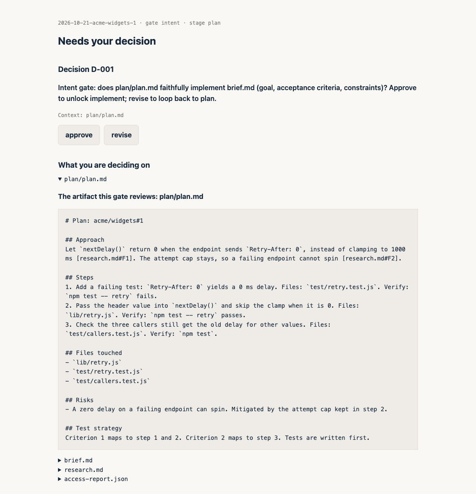
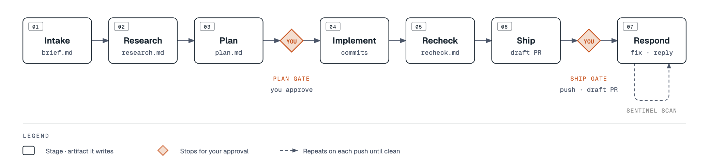

# Detent

**Ticket in. Draft PR out. The plan waits for your yes before any code is written.**

## The problem

A coding agent that works from a ticket can plan something the ticket did not ask for, review its own diff, and push. A team that lets agents open PRs needs two things. A human approves the plan before any code exists, and the review and the evidence come from something other than the author before anything is pushed.

Branch protection and required review already stop an agent PR from merging. They act after the code exists, so a wrong plan costs a full implement and review cycle, and the reviewer reads evidence the author gathered. Detent adds one human check before implement, and takes review from a separate reviewer command and evidence from a separate test command.

One committed run shows both, on [detent-demo#1](https://github.com/Amanborn007/detent-demo/issues/1) ("Add a maxLength option to slugify"). It ended in [PR #2](https://github.com/Amanborn007/detent-demo/pull/2), merged 2026-10-21. The change is a toy one in a demo repo, so this shows the mechanism and nothing about how often it matters. The decisions are in [decisions.json](docs/examples/2026-10-20-amanborn007-detent-demo-1/decisions.json).

- **D-002.** The plan added a documentation step the ticket never asked for. The run asked instead of silently doing it. The answer was "keep step 4".
- **D-004 and D-005.** At ship there was no reviewer socket and no verifier socket. The only review was the agent's own pass, which "found no blocking issue", and the evidence was gathered by hand. The human refused both ("wanted a reviewer independent of the author", "evidence from the author is not independent"), and both sockets were then wired.
- **D-007.** The wired `claude-reviewer`, a separate headless Claude call, found that an empty or alphanumeric separator lets the `maxLength` cut split words. The PR fixed it by rejecting a word-character separator when `maxLength` is set, with the failing test committed first.

## See it run

You need Node 20 and `git`. This runs the real engine from `detent setup` to the plan gate in a few seconds. It needs no install, no network and no LLM.

```sh
git clone https://github.com/Amanborn007/detent && cd detent
bash docs/demo/try.sh
```

```
✓ setup    wrote detent.user.yaml, stack.yaml
  still yours to fill: user.teams, user.jira_account
✓ run      2026-11-10-acme-widgets-1 created
  next stage: intake
✓ ticket   acme/widgets#1  "Retry delay drifts when Retry-After is 0"
✓ intake   done  (brief.md on disk)
✓ research done  (research.md, access-report.json on disk)
■ plan     written, held at the intent gate (D-001 pending)
■ gate     waiting on you: intent gate D-001 (approve or revise)
  page: $DETENT_ROOT/.plans/2026-11-10-acme-widgets-1-intent.html
```

A stub stands in for your tracker and canned files stand in for Claude's stage output. Every stage transition and gate comes from the engine. The script prints the gate page path and the scratch directory to delete.

In a real run the plan gate opens as a local curator page, and you click **Approve the plan** or **Send it back**. In this offline demo the page is a static preview, and its buttons do nothing. Recordings of the same flow are listed in [docs/demo/README.md](docs/demo/README.md).

<p align="center"><picture>
  <source media="(prefers-color-scheme: dark)" srcset="docs/assets/demo-gate-dark.png">
  
</picture></p>

**A real run.** The committed run went through all 7 stages. Reviewer round 1 raised the separator split and a `RangeError` on `Infinity`, round 2 flagged a JSDoc that over-promised, and round 3 had no findings. The verifier passed with `npm test`. Read the [run folder](docs/examples/2026-10-20-amanborn007-detent-demo-1/), what it does and does not prove in [docs/examples/README.md](docs/examples/README.md), or [PR #2](https://github.com/Amanborn007/detent-demo/pull/2).

## Use it on your repo

You need Claude Code with plugins, Node 20, `git`, `bash`, `jq`, `python3` and a signed-in `gh`. Curator opens its gate pages on `127.0.0.1`, so a sandbox that blocks local ports blocks the gates. In Claude Code:

```
/plugin marketplace add Amanborn007/detent
/plugin install detent@detent
```

Then, from a clone of this repo, run `scripts/detent-install.sh`. It npm-links the CLI and appends `DETENT_ROOT` to your shell profile. It needs a writable npm global prefix. If the prefix is not writable, the script prints `WARN` for each `npm link` and still ends with `done`, so set `npm_config_prefix` to a directory you own and run it again. The other install details are in [GUIDE.md section 2](GUIDE.md#2-first-run).

Then open a new shell, so that `DETENT_ROOT` is set and `detent` is on your `PATH`:

```sh
cd ~/code/your-repo
detent setup --repo .   # writes stack.yaml here, which doctor checks
detent doctor
detent start your-org/your-repo#123
detent continue     # one step
detent status       # stages, the gate waiting on you, the next step
detent decide       # open the waiting gate in curator
detent approve      # or answer the plan gate in this terminal
```

Replace `your-org/your-repo#123` with a real issue in a repo whose `origin` is on GitHub. `start` needs that remote and a signed-in `gh`. The only offline path is `docs/demo/try.sh` above.

In Claude Code the same verbs are `/detent:start`, `/detent:continue` and `/detent:status`, and `continue` runs the stage in your session. `approve` and `revise` refuse inside Claude Code, inside a drive child and without a TTY ([PR #24](https://github.com/Amanborn007/detent/pull/24)). So an agent cannot answer the plan gate through these verbs, and a drive child cannot answer one at all. An agent with file access can still edit `decisions.json` ([SECURITY.md](SECURITY.md)).

**What spends credit.** In a terminal, `detent continue` starts a headless Claude after you confirm a budget. The `claude-reviewer` adapter spends tokens on every call. `detent drive` runs intake, research and plan unattended, is experimental, and spends credit (default budget 5 USD per invocation). `try.sh` is offline and model-free.

## How it works

<p align="center"><picture>
  <source media="(prefers-color-scheme: dark)" srcset="docs/assets/detent-pipeline-dark.png">
  
</picture></p>

| Stage | What Detent does |
|---|---|
| intake | Writes `brief.md`. Each unknown becomes a decision you answer. |
| research | Asks every knowledge source you plugged in, and names any it could not reach. |
| plan | Writes the plan with a verify command per step, then waits at the plan gate. |
| implement | Commits red then green in a separate worktree. Never touches your checkout. |
| recheck | Compares the diff with the approved plan. Drift goes back to you. |
| ship | Runs your reviewer and verifier, shows the evidence, waits for your yes, then opens a draft PR. |
| respond | After you mark the PR ready, fixes the bot comments your policy allows and passes the rest to you. |

The CLI enforces the plan intent gate in code, where you click **Approve the plan** or **Send it back** ([GUIDE.md](GUIDE.md#3-the-stages-and-gates)). The drift and ship gates are rules in the stage prompts, recorded as pending decisions that block the stages they name. Nothing in the code calls `gh pr merge`.

Your tracker, docs search, reviewer and test runner plug in as sockets. A socket is a command you configure in `stack.yaml`. The engine writes one JSON request to its stdin and reads one JSON response from its stdout. Exit 0 is ok, exit 1 is retried once and then shown to you, and exit 2 halts the stage and asks. Six adapters ship in `engine/adapters/`. See [GUIDE.md section 5](GUIDE.md#5-sockets-and-providers) and [section 6](GUIDE.md#6-writing-a-provider-and-a-pack).

The plugin has 14 skills, typed as `/detent:<skill>`. `start`, `continue`, `status` and `drive` run the stages. The other ten are helpers the stages do not need, listed in [docs/REFERENCE.md](docs/REFERENCE.md#skills).

## Testing

```sh
node --test --test-timeout=300000 engine/*/test engine/*/tests
bash engine/owl/test/run-tests.sh
for f in hooks/tests/*.sh scripts/tests/*.sh engine/scripts/tests/*.sh; do bash "$f"; done
```

The suite needs to bind `127.0.0.1` and write to `/tmp`. Failures that read `listen EPERM` or `Operation not permitted` mean the sandbox blocked one of those.

[CI run 42786785915](https://github.com/Amanborn007/detent/actions/runs/42786785915) on main at 0731283, 2026-11-10, passed on ubuntu and macOS with 2089 tests, 2065 pass, 0 fail, 24 skipped, and owl 88 pass, 0 fail. The 24 skips are tests gated on `DETENT_LIVE_CLAUDE=1`, `DETENT_LIVE_HOSTBOX=1`, `DETENT_LIVE_OLLAMA` or `DETENT_LIVE_OPENAI`, plus one sandbox probe that runs only when nested.

Some of the edge cases it covers:

- `engine/cli/tests/gates.test.mjs`: `stage end` refuses while a decision that blocks that stage is pending.
- `engine/cli/tests/drive-claude-tmp.test.mjs`: the 44-byte bound on the claude tmp path is exact, so 44 passes and 45 fails with a clear error. The bound comes from the AF_UNIX path limit.
- `engine/cli/tests/drive-egress.test.mjs`: a DNS answer in a loopback, RFC1918, link-local, metadata or v4-mapped range is refused, and the proxy dials nothing.
- `engine/curator/test/auth.test.mjs`: a foreign `Host` is refused, an unauthenticated request with a bad JSON body gets 401, and `OPTIONS` gets 405.
- `engine/owl/test/run-tests.sh`: reset on failure, a no-op counts as failure, the three-failure kill switch, and the iteration cap.

Failing tests are committed before the fix. When a committed test has to change, the commit says so, for example 8f7d47a ("user-approved frozen-test change"). Not in CI: the `docs/demo` tests and `smoke.sh`, and the adapter smoke tests, which need network access to GitHub. Owl is tested only against a stub `claude`.

## Known limitations

- Only the plan gate is enforced in code. The drift and ship gates are prompt rules plus blocking decisions.
- After a PR is marked ready, `respond` and the `sentinel-inbox-check` Stop hook push fixes without per-item approval, for up to the round cap (10 by default). [What runs without asking you](docs/REFERENCE.md#what-runs-without-asking-you) lists every such part and its kill switch.
- Drive is experimental and spends credit. `--restricted` is not an OS sandbox, and `--budget` can overshoot by one turn.
- `drive --implement` ([PR #41](https://github.com/Amanborn007/detent/pull/41)) is macOS only, and its live end-to-end run is unverified.
- Curator auth does not protect against another process running as you. See [SECURITY.md](SECURITY.md).
- In the example, `respond` converged on its first scan because no bot had commented on the PR (`respond/round-1.json`).
- The regex tagger in `engine/index` is the only one tested. The tree-sitter path runs only if you install the optional deps, and it is untested ([PR #22](https://github.com/Amanborn007/detent/pull/22)).
- With `DETENT_ROOT` unset, `curator open` fails with ENOENT on `<clone>/.local` until that directory exists. `scripts/detent-install.sh` sets `DETENT_ROOT`, and `mkdir .local` in the clone also avoids it. The fix is [PR #51](https://github.com/Amanborn007/detent/pull/51).

## Read more

[docs/ARCHITECTURE.md](docs/ARCHITECTURE.md), [docs/DECISIONS.md](docs/DECISIONS.md), [CHANGELOG.md](CHANGELOG.md), [GUIDE.md](GUIDE.md), [docs/REFERENCE.md](docs/REFERENCE.md), [SECURITY.md](SECURITY.md) and [CONTRIBUTING.md](CONTRIBUTING.md).

Inspired by Kun Chen's MIT-licensed no-mistakes, lavish-axi and gnhf. No code was copied, see [NOTICE](engine/NOTICE.md). Licensed under [Apache 2.0](LICENSE).
