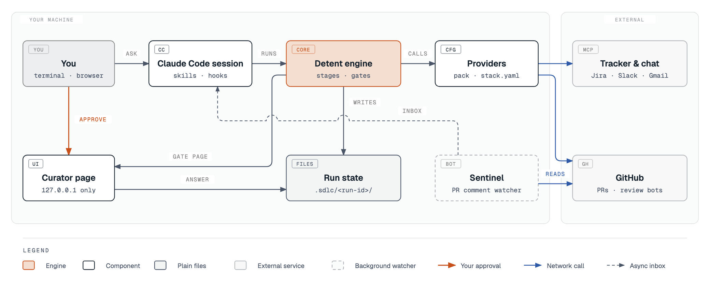

# Architecture

Detent is a Claude Code plugin (14 skill directories under `skills/`, hooks in `hooks/hooks.json`) on top of a Node CLI engine and a few local tools. Run state is plain files. `engine/cli`, `engine/curator` and `engine/sentinel` have no runtime npm dependencies. `engine/index` has two optional tree-sitter dependencies and falls back to a regex tagger without them.

  <picture>
    <source media="(prefers-color-scheme: dark)" srcset="assets/detent-architecture-dark.png">
    
  </picture>

## Components

| Component | Path | What it does | Talks to |
|---|---|---|---|
| Umbrella CLI | `engine/cli/detent.mjs` | Routes the crew names (`curator`, `sentinel`, `owl`, `herald`, `courier`, `feedback`, `index`) to their tools. Every other verb goes to the engine. | the engine, the tools below |
| Engine state machine | `engine/cli/engine.mjs` | `run new`, `next`, `stage begin` and `end`, `gate open` and `collect`, `socket call`, the friendly verbs, `bench`, `eval`. | run files, socket commands, the bundled curator CLI, git |
| Gate pages | `engine/cli/gate-page.mjs`, `markdown.mjs`, `render.mjs` | Render decisions and artifacts as an escaped HTML page under `.plans/`. | curator |
| Stage prompts | `engine/stages/{intake,research,plan,implement,recheck,ship,respond}/`, `CONTRACT.md`, `WALKTHROUGH.md`, `DRIVEN.md` | What the agent does at each stage, the run file layout and the decision schema. | the engine, through CLI calls |
| Sockets | `engine/sockets/*.md` | Nine contracts: `ticket`, `knowledge`, `skill-discovery`, `reviewer`, `verifier`, `bot-comments`, `skills-pack`, `incident`, `deploy-harness`. | your commands in `stack.yaml` |
| Adapters | `engine/adapters/` | Six built-in socket implementations: `gh-ticket`, `repo-docs-knowledge`, `repo-index-knowledge`, `gh-bot-comments`, `claude-reviewer`, `cmd-verifier`. | `gh`, `claude`, your test commands |
| Curator | `engine/curator/` | Local review page on `127.0.0.1`, random port, secret-based auth. Gate answers come back as JSON. | the browser, the engine |
| Sentinel | `engine/sentinel/` | Reads PR bot comments and classifies them with the config it is given. The respond stage passes `config/sentinel/default.json`. | `gh` |
| Owl | `engine/owl/owl.sh` (bash) | Unattended loop under caps. Commits locally, never pushes. | `claude`, git |
| Drive | `engine/cli/drive/` | Contained headless `claude -p --restricted` children for intake, research and plan. `--implement` is experimental, macOS only, and runs a Bash-only child under Claude Code's sandbox. | `claude`, curator, the run directory |
| Runtime port | `engine/runtime/` | One normalised model call for the reviewer and the eval judge, with `claude-code` and `openai-compatible` adapters. | the `claude` CLI, or an OpenAI-compatible endpoint |
| Repo index | `engine/index/` | Writes a profile, map, symbols, history and `manifest.json` to `.detent/index/`. | `git ls-files` |
| Eval and bench | `engine/eval/`, `evals/`, `engine/bench/`, `benchmarks/` | A deterministic eval gate scored against `evals/baseline.json`, and a run timing ledger. | CI |
| Leak gate | `engine/scripts/company-strings-check.sh`, `.github/workflows/leak-gate.yml` | Greps every PR for strings on a private denylist. The workflow fails when the denylist secret is missing. | CI |

If you are reading for the core, the path from intake to ship is `engine/cli/engine.mjs`, `engine/stages/`, `engine/sockets/`, `engine/adapters/` and `engine/curator/`. Everything else is a helper around it.

`engine/` also holds `curator-triggers`, `herald`, `courier`, `scout`, `examiner`, `self-feedback`, `handoff`, `statusline`, `spend`, `routing`, `pack`, `sources` and `lexicon`. They are optional crew that the 7-stage run does not need. The ones that ship as skills or `detent` verbs are in [docs/REFERENCE.md](REFERENCE.md).

## One run

1. `detent run new` creates the run directory and a git worktree at `<run>/worktree` on branch `sdlc/<run-id>` (`cmdRunNew` in `engine/cli/engine.mjs`).
2. Intake calls the `ticket` socket and writes `brief.md`. Each unknown becomes a pending decision in `decisions.json`.
3. Research asks every `knowledge` provider, then writes `research.md` and `access-report.json`.
4. Plan writes `plan/plan.md` and the engine renders a gate page into `.plans/`. You answer in curator, and `detent gate collect` writes the answer into `decisions.json` only if it is exactly one of the options.
5. Implement commits red then green in the worktree. Recheck diffs against the approved plan and writes `recheck.md`.
6. Ship calls the `reviewer` and `verifier` sockets, shows the evidence, records the ship decision, and after your yes pushes the branch and opens a draft PR.
7. Respond starts after you mark the PR ready. It runs sentinel scans and fixes what `config/sentinel/default.json` allows.

The file layout and decision schema are in [engine/stages/CONTRACT.md](../engine/stages/CONTRACT.md). A fictional ticket traced through every stage is in [engine/stages/WALKTHROUGH.md](../engine/stages/WALKTHROUGH.md). Which gates the code enforces is in [GUIDE.md](../GUIDE.md#3-the-stages-and-gates).

## Trust boundaries

- Text from tickets, PRs, bots and threads is data. Skills read it and never follow instructions found in it.
- The CLI enforces the plan `intent` gate. The drift and ship gates are rules in the stage prompts, recorded as pending decisions that block the stages they name.
- `approve` and `revise` refuse when `CLAUDECODE` is set, when `DETENT_DRIVE_CHILD=1`, or without a TTY (#24). These are environment checks, and `DETENT_FORCE_TTY=1` skips the TTY one, so they stop an agent that uses the verbs as given and not one that edits its environment. The drive outbox validator refuses `answer`, `status` and `answered_*` keys on child decisions (`engine/cli/drive/outbox.mjs`), and the integrity digest fails the step as `state_tampered` if run state changed (#17).
- A drive child for intake, research and plan gets file tools only, a read-only empty working directory, a `git archive` export with no `.git`, and an outbox, the only place it can write, which drive validates and secret-scans (#17). The `--implement` child is Bash-only under Claude Code's sandbox, with a shim and post-run checks (#41).
- Curator keeps a mode 0600 secret, proves itself to the CLI with an HMAC, checks `Host` on every request, and checks `Origin` when one is sent (#21).
- The leak gate fails a PR that contains a string from a private denylist.

[SECURITY.md](../SECURITY.md) lists what each of these does not cover.

## Where state lives

| Path | Holds | In git |
|---|---|---|
| `$DETENT_ROOT/.sdlc/<run-id>/` | `run.json`, `stage-status.json`, `decisions.json`, `events.jsonl`, `decision-rationale.jsonl`, `brief.md`, `research.md`, `access-report.json`, `plan/`, `recheck.md`, `verify/`, `respond/`. The code is in `<run>/worktree`. | No, `.sdlc/` is ignored |
| `$DETENT_ROOT/.plans/` | Gate pages and other curator pages | No |
| `$DETENT_ROOT/.local/curator`, or `CURATOR_STATE_DIR` | Curator secret and server state | No |
| `~/.sentinel` | Sentinel state and config | No |
| `<work repo>/.owl/` | Owl run logs and decisions | Owl adds no ignore rule for it |
| `<work repo>/.detent/index/` | Repo index, added to `.git/info/exclude` unless you pass `--commit` | No |
