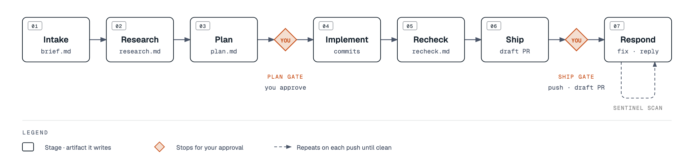

# Detent reference

The full manual. For the short version, start at the [README](../README.md).

## What it does

You give detent a ticket or a requirement. It researches the change, writes a plan, and waits for you to approve the plan. Then it implements the plan in a git worktree, checks the diff against the plan, and stops again before it pushes. After you approve, it pushes a branch and opens a draft PR. Once you mark the PR ready, it triages the comments that review bots leave and fixes the ones your policy says to fix.

Detent is two kinds of parts:

- **Skills** are prompts that Claude loads when your intent matches or when you type a slash command.
- **Tools** are small Node and shell programs: `detent`, `curator`, `sentinel`, `owl`. They hold the state machine, the gates and the PR scans, so those run the same way every time.

Your tracker, knowledge sources, reviewer and verifier are not built in. You declare them as commands in a YAML file, and the engine calls them with JSON on stdin and reads JSON from stdout.

## What runs without asking you

Most of detent waits for you. These parts do not:

- **Hooks run on their own.** After `git push`, `gh pr create` or `gh pr ready` on a branch with an open PR, `sentinel-autoscan.sh` asks the session to run a referee review and, for a non-draft PR, starts a detached read-only scanner. Other hooks add reminders to the model's context or keep a turn open. See [Hooks](#hooks).
- **After a PR is ready, fixes need no per-item approval.** The respond stage, and the `sentinel-inbox-check` Stop hook that keeps its loop running, push fixes and reply to and resolve bot threads. They stop at the round cap in the sentinel config, 10 by default. This works even when no engine run exists.
- **Curator is a local web server.** It binds `127.0.0.1` on a random port and stops after 60 minutes idle.

Detent has no telemetry. It never merges: nothing in the repo calls `gh pr merge`. Set the kill switches under [Hooks](#hooks) to turn the automatic parts off.

## Requirements

- Claude Code with plugin support. No minimum version is pinned.
- Node.js 20, `git`, `bash`, `jq`, `python3` and `npm`.
- The GitHub CLI `gh`, signed in with `gh auth login`.
- Optional MCP connectors in your Claude Code session: Atlassian for clerk, Slack, Gmail and Jira for herald and scribe.

`python3` is needed because `curator open` runs a page check with it. `npm` is needed once, for the install script.

## Install

Install the plugin from inside Claude Code, then restart it:

```
/plugin marketplace add Amanborn007/detent
/plugin install detent@detent
```

The plugin gives you the skills and the hooks. It cannot put programs on your `PATH` or set an environment variable, so clone the repo and run the install script once:

```sh
git clone https://github.com/Amanborn007/detent && cd detent
scripts/detent-install.sh
```

The script links `curator` and `detent` onto your `PATH`, adds `DETENT_ROOT` and a `detent-upgrade` alias to your shell profile, and copies `detent.user.example.yaml` to `detent.user.yaml`. It does not edit `~/.claude/settings.json`, and it is safe to run again. There is no `engine` command on your `PATH`. Use `detent <command>`, or `node engine/cli/engine.mjs <command>` from the clone.

Open a new shell, then check the result:

```sh
detent help
curator status
detent sentinel config-check --config config/sentinel/default.json
```

Run `detent-upgrade` to update. It fast-forwards the clone and updates the plugin. Add `--reinstall` to reinstall the plugin. Without `DETENT_ROOT`, hook state lands in the plugin cache, so run the install script before you rely on the hooks.

## Quickstart

Skills are namespaced by the plugin, so you type them as `/detent:<skill>`. Fill in `detent.user.yaml` first: at least `user.name` and `user.email`, because herald stops without them.

**Review a PR.** This needs a review skill named in the pack, see [Configuration](#configuration).

```
/detent:referee https://github.com/your-org/your-repo/pull/123
```

On your own PR, referee shows its findings and a fix plan, and changes nothing until you approve. On someone else's PR it drafts inline comments and posts them only after you approve the plan. Add `--describe` to get the review as a curator page. `/detent:deslop` runs without a pack entry.

**Look at a plan.** Ask Claude to render any plan, comparison or report in curator, or open a page yourself:

```sh
detent curator open "$DETENT_ROOT/.plans/my-plan.html"
detent curator poll "$DETENT_ROOT/.plans/my-plan.html"
```

`open` checks the page with `engine/curator/scripts/artifact-check.py` and refuses a page that fails. `poll` waits and prints your clicks and annotations as JSON.

**Drive a run.** Copy `engine/stack.example.yaml` to `stack.yaml` in your work repo and wire at least the `ticket` socket, then:

```sh
detent run new --ticket owner/repo#12 --repo ~/code/your-repo
detent next --repo ~/code/your-repo
```

`run new` creates the run directory and a worktree on branch `sdlc/<run-id>`. `next` prints the command to run next. Then ask Claude to follow `engine/stages/<stage>/SKILL.md` for that run id, and run `detent next` again after each stage. `detent dashboard` lists every run. `owner/repo#12` assumes the built-in `gh-ticket` adapter. These commands need a real install and a real ticket, so they are not run in this repo's CI.

## How a run works

<p align="center">
  <picture>
    <source media="(prefers-color-scheme: dark)" srcset="assets/detent-pipeline-dark.png">
    
  </picture>
</p>

A run has seven stages: intake, research, plan, implement, recheck, ship and respond. `detent stage begin` refuses to start a stage while an earlier one is not done or skipped, or while a pending decision blocks it. `detent stage end` refuses to finish a stage whose required artifact is missing.

| Stage | Required artifact | What happens |
|---|---|---|
| intake | `brief.md` | Fetch the ticket through the `ticket` socket and write the brief. Each open question becomes a pending decision. |
| research | `research.md`, `access-report.json` | Ask the knowledge providers and the repo, and name any source that could not be reached. |
| plan | `plan/plan.md` | Write the plan and render it in curator for your approval. |
| implement | none | Commit test-first steps on `sdlc/<run-id>` in a worktree. Does not push. |
| recheck | `recheck.md` | Compare the diff with the approved plan. Drift becomes a decision. |
| ship | none | Run review and verification through your sockets, then ask before the first push and the draft PR. |
| respond | none | After you mark the PR ready, run sentinel scans and handle bot comments. |

**Which gates the engine enforces.** The CLI enforces one gate itself: the plan `intent` gate, with the answers `approve` or `revise`. The drift gate (accept, back to plan, back to implement) and the ship gate are rules in the stage prompts. The agent records them as pending decisions in `decisions.json`, and a pending decision blocks the stages it names. A prompt can be followed badly, so read each gate before you answer it. Recheck also checks that the recorded red commit is an ancestor of the green commit. That proves the order of the commits, not that the test was seen to fail.

**How you answer a gate.** `detent gate open <id>` writes `.plans/<run-id>-<gate>.html` with one question per pending decision and the stage artifacts embedded. `curator open` shows it. After you click, `detent gate collect --run <run-id>` runs `curator drain` for that run's gate pages only and writes an answer into `decisions.json` only when it exactly matches one of the decision's options. Other feedback goes to `review-feedback.jsonl`. Without curator you can edit `decisions.json` by hand.

**Drive (experimental).** `detent drive` is experimental, runs on macOS and Linux only, and spends Claude credit: it stops at `--budget` (default 5 USD per invocation). It runs intake, research and plan with one `claude -p --restricted` child per stage: file tools only, no Bash, a scrubbed environment, and an outbox that drive validates before it writes any run state. It never implements or ships. Stops are `needs_human`, `before_implement`, `max_steps`, `budget`, or a failure such as `state_tampered`, `outbox_rejected` or `secret_detected`.

**Run state.** Each run lives in `${DETENT_ROOT}/.sdlc/<date>-<ticket>[-slug]/` with `run.json`, `stage-status.json`, `decisions.json`, `events.jsonl`, `gates/`, `handoff/` and `worktree/`. Run ids never change, so a re-run is a new run. Every command prints one JSON line with a `next_step`. Exit 0 is ok, 1 is a provider or environment failure, and 2 is a refusal with a `reason`.

[GUIDE.md](../GUIDE.md) has the stage details. `engine/stages/WALKTHROUGH.md` traces a fictional ticket through all seven.

## Configuration

Three files wire detent up. They are separate files, and mixing them up is the most common setup error.

| File | Lives in | Read by | Holds |
|---|---|---|---|
| `detent.user.yaml` | the clone, gitignored | skills and hooks | You: name, email, GitHub login, teams, voice file, org, pack path. |
| Provider pack | `packs/example/stack.yaml`, or the file named by `pack.path` | referee, scout and other skills | Knowledge providers, review lenses, incident and analytics hooks, network check. |
| Engine `stack.yaml` | your work repo, or `--stack <path>` | the engine CLI | A top-level `sockets:` map of commands. Start from `engine/stack.example.yaml`. |

**`detent.user.yaml`** comes from `detent.user.example.yaml`. The install script creates it. An empty `github_login` is read from `gh api user`.

```yaml
user:
  name: ""
  email: you@example.com
  github_login: ""
voice:
  file: null
org:
  github_owner: your-org
pack:
  path: null
```

**The provider pack** turns features on or off. A null field turns that feature off, and the skill that needs it says so in one line. Check the pack with `detent pack validate`, which lists what is on and off. It exits 2 and lists `errors[]` when the pack is invalid.

```yaml
review:
  lenses:
    - {id: cross-system, kind: skill, skill: null, probe: {provider: org-kb, required_corpus: services}}
    - {id: principal, kind: skill, skill: null}
    - {id: deslop, kind: builtin}
```

The example pack ships with `skill: null` on both the `cross-system` and `principal` lenses, so referee has no reviewer until you name a PR-review skill in one of them. The `org-kb` knowledge provider in the example is a placeholder for your own MCP server.

**The engine `stack.yaml`** binds sockets to commands. The sockets are `ticket`, `knowledge`, `skill-discovery`, `reviewer`, `verifier`, `bot-comments`, `skills-pack`, `incident` and `deploy-harness`. A socket you leave out is off, and a command that needs it refuses and names it.

```yaml
sockets:
  ticket:
    command: "/path/to/detent/engine/adapters/gh-ticket"
    version: "builtin"
  bot-comments:
    command: "/path/to/detent/engine/adapters/gh-bot-comments"
    version: "builtin"
```

There are five built-in adapters: `gh-ticket`, `gh-bot-comments`, `repo-docs-knowledge`, `claude-reviewer` and `cmd-verifier`. `claude-reviewer` fills the `reviewer` socket. It needs a signed-in `claude` CLI, it spends tokens on every call, and it runs `claude` with no tools, no MCP servers and no user or project settings because the reviewed repo is untrusted. `cmd-verifier` fills the `verifier` socket. It runs the `--test` command, then the `--evidence` command, and passes only when the tests pass and every claim has an evidence line. Both commands run in the shell inside the repo, so they must come from your own `stack.yaml`. The evidence command prints one JSON object per line with `claim`, `kind`, `note` and an optional `artifact`. Point `--out` at a git-ignored directory, because the saved test and evidence output would otherwise show up in the diff.

A command provider reads one JSON request on stdin and writes one JSON response on stdout. Exit 1 is retried once, then shown to you. A `providers:` list under a socket fans out to every entry and merges the results. A provider with `kind: skill` or `kind: mcp_tool` makes the engine print an instruction for the agent, because the CLI cannot call a skill or an MCP tool itself. Use absolute paths for adapters. A relative path resolves against the directory of your `stack.yaml`, so it fails in a work repo. The `version` field records the contract you wrote against, and the engine does not check it. If the engine says `has no 'sockets:' map`, you pointed it at the pack. Socket contracts are in `engine/sockets/`.

Sentinel's bot policies are in `config/sentinel/default.json`: six bots, each with a policy of `auto_address`, `ignore` or `escalate`, and `max_iterations` of 10. Copy it and change the logins for the bots your org runs.

## Skills

Ten skills ship in the plugin. Four are slash-only and Claude never loads them by itself: clerk, examiner, herald and owl.

| Skill | Invoke | What it does | Writes or sends | Gated |
|---|---|---|---|---|
| clerk | `/detent:clerk <requirement or ticket key>` | Checks which sources it can reach, researches precedent, lists approaches, drafts tickets. Given an existing ticket it creates only what is missing. | Jira tickets through your Atlassian connector. Curator pages. Then `detent run new` for each key. | Yes. You approve the approach, then the ticket set. |
| scout | automatic in research, or ask | Sends one question to every knowledge provider in the pack plus the repo docs, and returns one ranked brief with a source for each claim. | Nothing outside the session. | No, read-only. |
| referee | automatic after push, or `/detent:referee <PR>` | Reviews a PR through the lenses the pack enables. Author mode plans fixes. Reviewer mode drafts comments. | Review comments on GitHub, or local fixes on your own branch. | Yes. Nothing posts or changes until you approve. |
| deslop | `/detent:deslop [PR]` | Finds restating comments, defensive try/catch on trusted paths, casts to `any` and style drift in your own diff. | Proposals only, through referee's checkpoint. | Yes. It never edits on its own. |
| scribe | `/detent:scribe` or ask for a reply | Reads a thread and the recent history of its channel, then drafts a reply for that surface. | A draft in Slack or Gmail, or text to paste. Never sends. | Draft only. |
| herald | `/detent:herald [-N]` | Builds the morning brief from owl results, open PRs, engine runs, and tracker, mail and chat if connected. | `.plans/morning-brief-<date>.html` and `.local/brief-state.json`. | Items you mark Act start work. |
| owl | `/detent:owl <objective>` | Runs an unattended loop in a separate process, one small verified step per iteration. | Commits on `owl/<slug>` and state in `<repo>/.owl/`. Never pushes. | You confirm the caps first. |
| curator | automatic for long output | Renders a plan or report as a self-contained page and returns your clicks as JSON. | Pages in `.plans/`. State and the server secret in `.local/curator/` (mode 0700). | It is the gate surface. |
| courier | automatic, or "fulfill reads" | Lets a headless step ask for data that only an interactive session can reach. Your session reads it and hands it back. | Requests in `.local/reads/`. | No. Detent stores no credentials. |
| examiner | `/detent:examiner <subject>` | Asks every open question about a plan in one curator round, each with a recommended answer and what breaks if it is wrong. | Answers, in `decisions.json` when inside a run. | You answer each question. |

Sentinel is a tool and a hook, not a skill. It sits in the same loop.

## Tools and CLI

`detent` is the one command. It sends `curator`, `sentinel`, `owl`, `herald`, `courier` and `feedback` to their own programs and everything else to the engine.

| Command | What it does |
|---|---|
| `detent setup --repo <path> [--force]` | First run: fill empty fields in `detent.user.yaml` from `git` and `gh`, and write a starter `stack.yaml` in the work repo. |
| `detent run new --ticket <ref> --repo <path>` | Create a run and its worktree. |
| `detent next` | Print the exact next command for the run. |
| `detent stage begin <stage>`, `detent stage end <stage>` | Move a stage, with the checks above. |
| `detent gate open <id>` | Render a pending gate as a curator page. |
| `detent gate collect --run <id>` | Write your curator answers into `decisions.json`. |
| `detent drive --run <id>` | Experimental, macOS and Linux, spends credit. Runs intake, research and plan with contained `claude -p --restricted` children (no Bash), then stops for you. `--budget` (default 5 USD). It never implements or ships. |
| `detent socket call <name>` | Call one socket by hand. |
| `detent dashboard`, `detent live <run-id>` | One curator page of all runs, or a live view of one run. |
| `detent respond --pr <url>` | Arm the respond stage on an open PR with no ticket. |
| `detent eval`, `detent bench`, `detent spend` | Evals, run timing, and measured Claude Code cost. |
| `detent pack validate` | Check the provider pack. |
| `detent sentinel scan --pr <url>` | One read-only scan of a PR. |
| `detent curator open\|check\|poll\|drain\|reply\|log\|answer\|end\|status` | The review surface. |

`detent help` lists the umbrella commands. `node engine/cli/engine.mjs help` prints the engine's commands as JSON. [GUIDE.md](../GUIDE.md) covers all of them.

## Hooks

The plugin registers 16 hook entries that run 14 scripts, listed in `hooks/hooks.json`. Nine of the scripts stand down inside Claude Code background jobs (`CLAUDE_JOB_DIR`), and `comment-discipline`, `deslop-check` and `eval-gate` also stand down inside owl runs (`OWL_RUN`). `sentinel-autoscan` runs in both.

| Event | Scripts | What they do |
|---|---|---|
| SessionStart | `morning-brief-session.sh` | On the first session of a day, offer the brief. |
| SessionStart | `cold-resume-warn.mjs` | When a resumed session's last turn is over an hour old, say the prompt cache has expired before the first turn runs. |
| SessionStart, and after Write or Edit | `comment-discipline.sh`, `voice-discipline.sh` | Remind the model of your code-comment rules and your writing voice. |
| After Bash | `sentinel-autoscan.sh` | After a push, `gh pr create` or `gh pr ready` on an open PR, request a referee review and start a scanner for non-draft PRs. |
| After Bash | `eval-gate.sh`, `deslop-check.sh` | After a push, remind the model to run the evals or `/detent:deslop`. |
| After ExitPlanMode | `curator-reminder.sh` | Remind the model to render the approved plan in curator. |
| After Write or Edit | `curator-md-nudge.sh` | Suggest curator when a large markdown file is written. |
| Stop | `curator-pending-feedback-check.sh`, `curator-stop-check.sh` | Hold the turn open while curator feedback waits or a review was never rendered. |
| Stop | `courier-autofulfill.sh`, `referee-owed-check.sh`, `sentinel-inbox-check.sh` | Surface pending reads, owed reviews and unread scanner rounds. |

The scanner waits 330 seconds, then scans every 300 seconds for up to 8 rounds. A new head commit restarts the window, up to 12 windows. Results go to `.local/inbox/<owner>__<repo>__pr<N>/respond-inbox.jsonl`, and the log is `sentinel-autoscan.log` in the same folder. Draft PRs get a referee review but no scanner.

`engine/statusline/session-cost-statusline.mjs` shows this session's spend and the share run in sub-agents. A plugin cannot set a status line, so add it to `~/.claude/settings.json` yourself:

```json
{
  "statusLine": {
    "type": "command",
    "command": "node /path/to/detent/engine/statusline/session-cost-statusline.mjs"
  }
}
```

Kill switches, each set to `off`: `PR_AUTOREVIEW`, `REFEREE_AUTOREVIEW`, `SENTINEL_AUTOSCAN`, `EVAL_GATE`, `DESLOP`, `VOICE_DISCIPLINE`, `MORNING_HERALD_SESSION` and `COLD_RESUME_WARN`. [hooks/README.md](../hooks/README.md) has the rest of the environment variables.

## Safety model

- **Gated:** clerk creating tickets, referee posting comments, the first push and the draft PR (the ship gate), and owl's caps, which you confirm before it starts.
- **Not gated per item:** once a PR is non-draft, the respond stage and the `sentinel-inbox-check` Stop hook push fixes and reply to and resolve bot threads, up to the round cap, with or without an engine run.
- **Never:** merging. Sentinel only reads. Scribe only drafts.
- **Untrusted text:** ticket, thread and PR text is data. A skill reads it and does not follow instructions found in it.
- **Owl:** runs under `--permission-mode dontAsk` with a settings profile and refuses a profile that sets `bypassPermissions`. The agent is denied `git commit` and `git push`. Owl commits for itself and never pushes. The default profile allows `node *` and `npm run*`, so read it before an unattended run. It stops at 8 iterations or 300 minutes, or after 3 failures in a row, unless you set other caps.
- **Drive (experimental):** the child is `claude -p --restricted` with file tools only, an allowlisted environment, a read-only copy of the repo and a write-only outbox that drive validates. It stops before implement and never ships. The trust model and the residual risks are in [SECURITY.md](../SECURITY.md).
- **Curator:** binds `127.0.0.1` and answers 403 to any other `Host` header.
- **Network:** `gh` calls to GitHub, plus `claude -p` from owl and the optional eval judge. Your own provider commands do what you wrote them to do. Connectors come from your Claude Code session, and detent stores no tokens.

Report a vulnerability through [SECURITY.md](../SECURITY.md).

## Evals and the leak gate

`detent eval` scores the repo's agent-facing behavior against `evals/baseline.json`. There are seven suites: `context-adherence`, `sentinel-golden`, `clerk`, `scout`, `referee`, `scribe` and `self-feedback`. The verdict is `UPGRADE`, `NEUTRAL` or `DEGRADE`, with a variance band of 0.05. The gate in `evals/config.yaml` is in `blocking` mode and arms after 5 green baseline runs are on record. A deterministic check that passed in the baseline and fails now blocks at once.

```sh
detent eval --changed --no-judge     # what CI runs
detent eval --rebaseline --no-judge  # after an intended change, then commit the baseline
```

The leak gate keeps company names and ticket keys out of the repo. `engine/scripts/company-strings-check.sh` greps for strings in `engine/.local/denylist.txt`, which you keep out of git. CI writes that file from the `LEAK_DENYLIST` secret, and a fork PR fails closed with exit 2 because it cannot read the secret. CI also runs gitleaks. [CONTRIBUTING.md](../CONTRIBUTING.md) shows how to run the check yourself.

## Where things live

```
.claude-plugin/    plugin and marketplace manifests
skills/            the ten skills
hooks/             hooks.json and the hook scripts
engine/
  cli/             detent.mjs and engine.mjs
  stages/          stage prompts and CONTRACT.md
  sockets/         socket contracts
  adapters/        gh-ticket, repo-docs-knowledge, gh-bot-comments, claude-reviewer, cmd-verifier
  curator/ sentinel/ owl/ herald/ courier/
  eval/ bench/ spend/ routing/ handoff/ scout/ self-feedback/ pack/ sources/
  scripts/         leak-gate script
packs/example/     the example provider pack
config/sentinel/   default bot policies
evals/             cases, config and baseline
docs/  scripts/  benchmarks/  teams/  lexicon/
```

Runtime state stays out of git. Runs are in `.sdlc/`, curator pages in `.plans/`, and sentinel inbox, team profiles, courier reads and brief state in `.local/`, all under the clone. Owl keeps `.owl/` in the work repo. Curator keeps `~/.curator` and sentinel keeps `~/.sentinel`.

## Troubleshooting

- **`curator open` fails.** Curator needs to bind `127.0.0.1` and needs `python3` on your `PATH`. A page that fails the check is refused, and `CURATOR_NO_CHECK=1` opens one unchecked.
- **`pack validate` exits 2.** Read `errors[]`. Each entry names a path and a field.
- **`has no 'sockets:' map`.** You gave the engine the provider pack. Point `--stack` at an engine `stack.yaml`.
- **`spawn failed` from a provider.** Use an absolute path to the command.
- **Hooks write state in the plugin cache.** `DETENT_ROOT` is not set. Run `scripts/detent-install.sh` and open a new shell.
- **No scanner after a push.** Check `gh auth status`, then whether the PR is a draft, then `sentinel-autoscan.log`.
- **A skill says a provider is missing.** The pack or `stack.yaml` has no entry for it. The skill says what it skipped.

## Status

This is early software. Here is what is and is not checked.

- **In CI** (`.github/workflows/eval.yml`): `detent eval --changed --no-judge`, and unit tests for `engine/eval`, `engine/self-feedback`, the curator artifact check and the curator CLI gate. A judge job runs only with an `ANTHROPIC_API_KEY` secret and is advisory. The leak gate runs in `leak-gate.yml`.
- **Not in CI:** the engine CLI tests, sentinel tests, hook tests, adapter smoke tests and the owl tests. They exist in the repo and are listed in [CONTRIBUTING.md](../CONTRIBUTING.md). Run them before you push.
- **Owl** is tested against a stub `claude` binary, not the real one.
- **The autoscan hook** is tested with stubbed `gh` output, not against a live PR in this repo.
- **The stages** are prompts plus a state machine. They have been run once end to end on [Amanborn007/detent-demo#1](examples/2026-10-20-amanborn007-detent-demo-1/).
- **Known gaps.** The stage prompts in `engine/stages/` are not registered as plugin skills, so you point Claude at them by path.

A worked example is committed: a full run on a small public repo, with the run directory in [docs/examples/2026-10-20-amanborn007-detent-demo-1/](examples/2026-10-20-amanborn007-detent-demo-1/) and the resulting [demo PR](https://github.com/Amanborn007/detent-demo/pull/2).

## Credits

The staged pipeline, the visual plan review and the long-run safeguards are inspired by MIT-licensed tools by Kun Chen: no-mistakes, lavish-axi and gnhf. No code was copied. See [engine/NOTICE.md](../engine/NOTICE.md).

## Contributing, security and license

Read [CONTRIBUTING.md](../CONTRIBUTING.md) before a pull request and [SECURITY.md](../SECURITY.md) to report a problem. More depth is in [GUIDE.md](../GUIDE.md), [engine/README.md](../engine/README.md) and [hooks/README.md](../hooks/README.md). Detent is licensed under Apache 2.0, see [LICENSE](../LICENSE).
